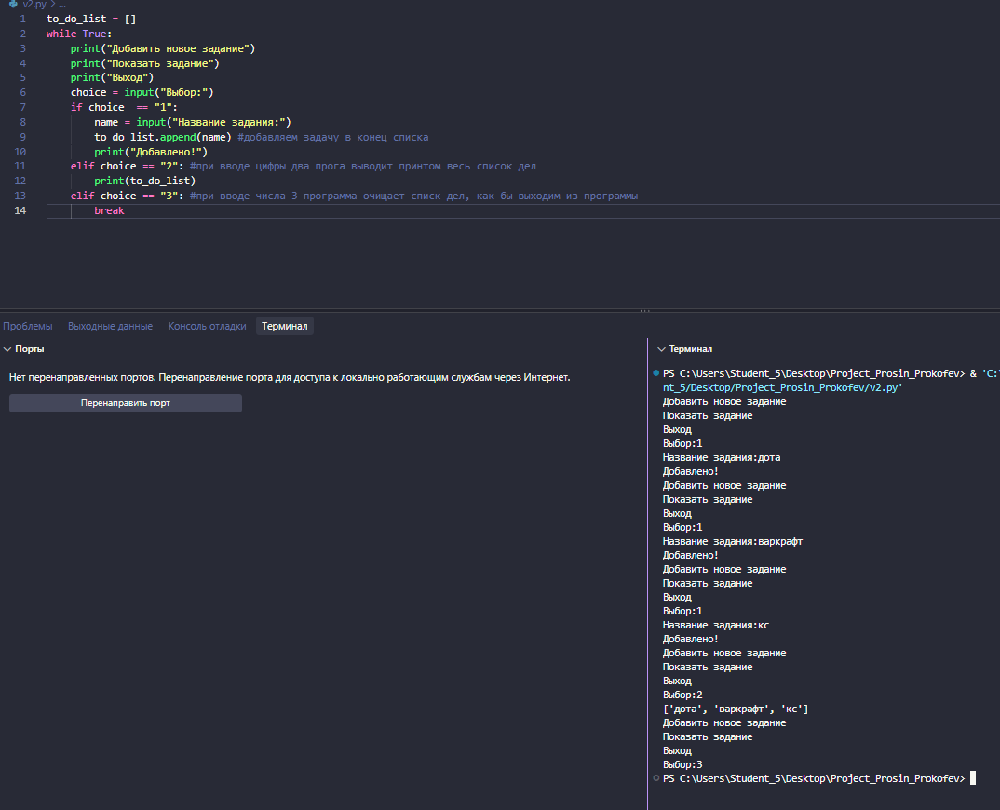
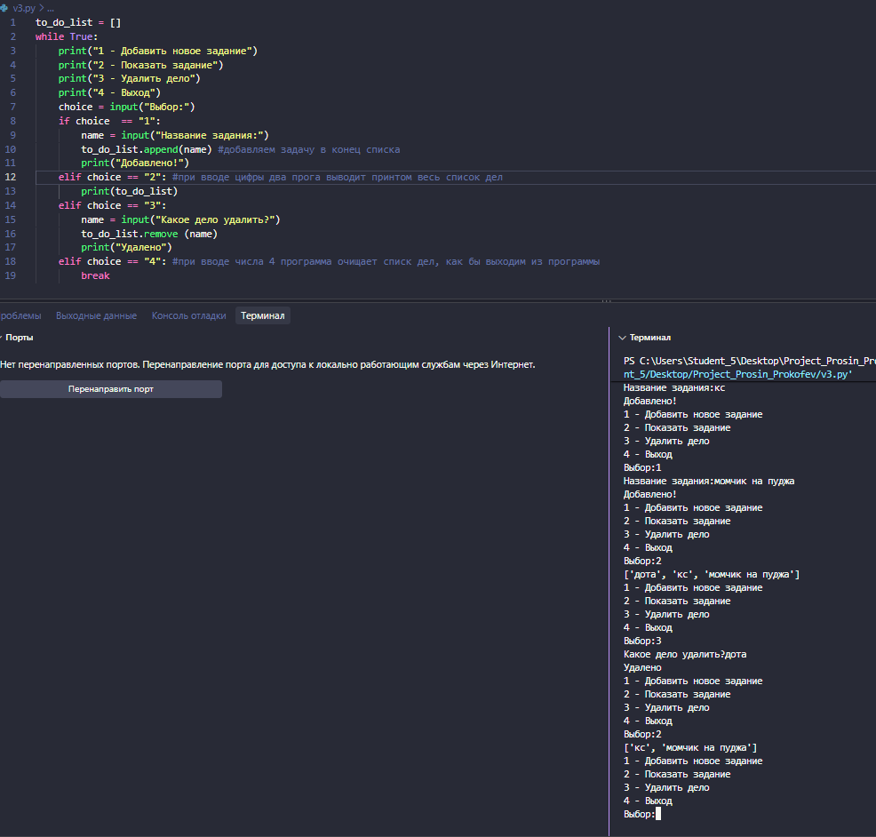

# Список книг
Простая программа на Python для записи, поиска и удаления книг.
## Как запустить
Откройте терминал в папке с программой и введите:
```bash
python v3.py
```
---
## Спринт 1. Первая версия (`v1.py`)
* **Что делает проект:**  Работает как "Заметки" целенаправленно ля списка ваших дел
* **Что сделали:** Добавили возможность добавлять дела и посмотреть их 

---


## Спринт 2. Доработка (`v2.py`)
* **Добавили:** добавили возможность очистить список

---
## Спринт 3. Запрос CR-1 и финал (`v3.py`)
* **Запрос CR-1:** одногруппник попросил сделать удаление дела из списка, после ее выполнения.
* **Сделали:** добавили пункт `3 - Какое дло удалить? `
* **Как пользоваться:**  После вывода вопроса "Какое дло удалить?" - напишите название дела которое хотите удалить

---
## Команда
* **Прокофьев** — код `v1.py`,`v2.py` и `v3.py`.
* **Просин** — проверка программы оформление README и выкладывание программы и README на Github